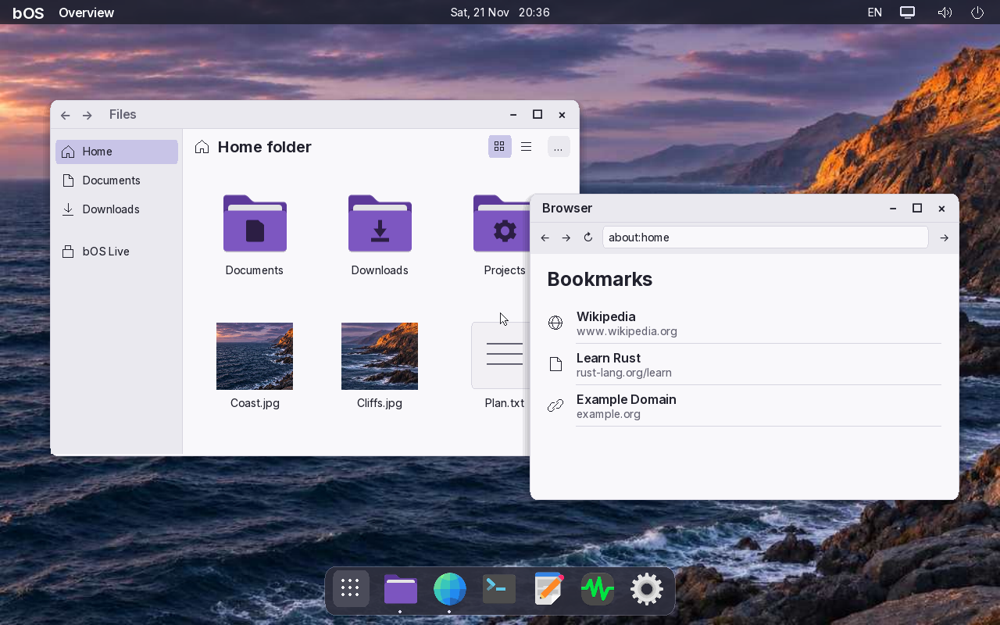
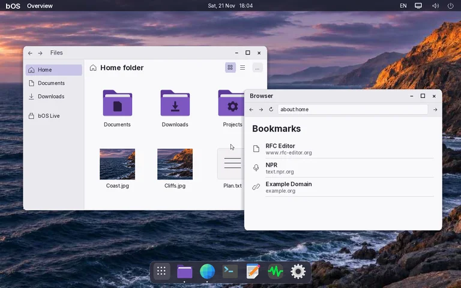
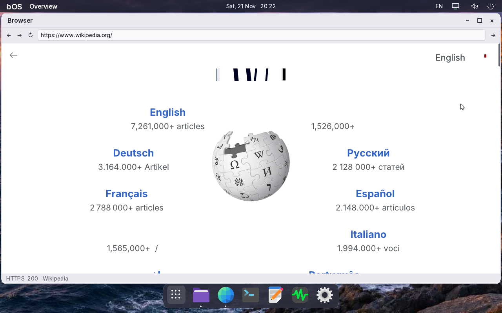

# bOS 1.0

[Download the Live disk](https://github.com/dr-lexus-dr/bOS/releases/download/v1.0.0/bOS-1.0.0-x86_64.img) · [Release and SHA256SUMS](https://github.com/dr-lexus-dr/bOS/releases/tag/v1.0.0) · [Русский](README.ru.md)

bOS is a bootable desktop operating system for x86-64 with its own Rust kernel. One USB image boots through BIOS or UEFI. It opens Files and Browser on an English desktop. The window manager, shell, network stack and web engine all run on the machine that boots the disk.



## Start a live session

Download the image and `SHA256SUMS` into the same directory and run `sha256sum -c SHA256SUMS`. Write the image to a USB stick in raw-image mode and choose the stick in the firmware boot menu. Writing the image replaces the contents of the chosen stick. A live session can use a read-only boot medium.

On Linux with QEMU and KVM, the downloaded image can also run directly from a file.

```sh
qemu-system-x86_64 -machine pc -accel kvm -cpu host -smp 1 -m 1G \
  -device VGA,vgamem_mb=8 \
  -drive if=none,id=stick,format=raw,readonly=on,file=bOS-1.0.0-x86_64.img \
  -device qemu-xhci -device usb-storage,drive=stick,bootindex=1 \
  -netdev user,id=lan -device rtl8139,netdev=lan,romfile=
```

For software emulation, replace `-accel kvm -cpu host` with `-accel tcg -cpu max,vendor=GenuineIntel`. Allow **1 GiB of guest RAM** for browsing. The image is about **17.5 MB**. On a PC, bOS uses a 32-bit VBE or GOP framebuffer, PS/2 keyboard and mouse input, and wired Ethernet. Supported NICs are Realtek RTL8139, Intel 82540EM and Intel 82574L. The tested firmware configurations are SeaBIOS and OVMF in QEMU. [Measurements and hardware coverage](CONSTRAINTS.md)

## The desktop

Drag a window by its title bar and resize it by its lower-right corner. Double-click the title to maximize. The dock restores minimized windows. Open the overview with **Super**, type an application name and press **Enter**. Right-click for file and window actions. Click the clock for a calendar or the network indicator for the connection state.



| Application | What it does |
| --- | --- |
| Files | Browse volumes as icons or a list. Create and rename items, copy directories, open text in Notes and preview JPEGs. |
| Browser | Open addresses or searches, follow links, enter text and submit forms. Go back, forward, reload or scroll a page. |
| Terminal | Run bSH commands and ring-3 programs. Each window has its own working directory, command history, color output and scrollback. Tab completes commands and paths. |
| Notes | Edit UTF-8 text, select by mouse or keyboard, copy, paste and save under a new name. |
| Calculator | Evaluate integer arithmetic with parentheses. |
| System Monitor | Follow CPU activity and inspect allocated RAM, uptime and open windows. |
| Settings | Change language, theme, accent, wallpaper, animation speed, shadows, transparency, clock and pointer speed. |
| Widgets | Operate a switch, slider and segmented control, test the PC speaker and save a text field. |
| Snake | Steer with the arrow keys or WASD. Space starts or pauses the game. |
| About | Inspect the version, architecture and source revision of the running system. |

The interface starts in **English**. Click **EN** on the top bar or select **Settings → Language → Русский**. **Ctrl+Space** changes the physical keyboard layout independently. **Alt+Tab** switches windows, **Alt+F4** closes the active window, and **F12** switches between the desktop and full-screen bSH. **Ctrl+L** focuses the browser address, **Ctrl+B/F** follows its history and **Ctrl+S** saves in Notes.

## Browse the web

The image carries go-webengine and its Goja JavaScript interpreter as a WebAssembly executable. Wasmi runs it inside the bOS kernel. The guest obtains an IPv4 lease over Ethernet, resolves DNS and validates HTTPS certificates against its clock and certificate roots. Each browser window has an in-memory cookie jar. The download includes the engine, fonts and CA roots, so the desktop and terminal start offline.



The browser lays out HTML and CSS including flex and grid, paints images and SVG, executes page scripts and submits URL-encoded forms. It presents a styled viewport while images and scripts continue loading. The guest tests check CSS sizing, a JavaScript color change, link navigation and an actual HTTP POST. Public HTTPS checks have opened Wikipedia, Example Domain and Learn Rust.

Web compatibility is partial. Large script-heavy applications can be slow or incomplete. Sites that depend on streaming video, DRM, WebRTC or a browser extension need capabilities outside this release. The native transport accepts up to 8 MiB per resource. A separate terminal command, `web https://example.com/`, provides a 64 KiB text view. [Web engine source](https://github.com/go-webengine/engine/tree/v0.48.0) · [Architecture](docs/ARCH.md)

## Files, shell and programs

Fresh sessions keep changes in RAM. To keep documents and settings across reboots, attach a separate FAT12 or FAT16 volume labelled **BOSDATA**, or an existing bFS users volume. It mounts at `/users`. The home folder is `/users/default`. Desktop preferences live in `.config/desktop.cfg`. From a source checkout, this example creates a new empty data disk.

```sh
mkdir -p target
test ! -e target/users-fat.img && truncate -s 16M target/users-fat.img && \
  mkfs.fat -F 16 -n BOSDATA target/users-fat.img
BOS_DATA=target/users-fat.img bash scripts/run-qemu.sh --live
```

The live disk includes seven ELF32 programs and implements the ClaudeOS `int 0x80` ABI with isolated address spaces, preemption, sleeping processes and background jobs. In Terminal or full-screen bSH, try the following.

```sh
hello one two
primes 30
counter 10 &
ps
ifconfig
mem
```

Use `joblog PID` to read a job's output and `kill PID` to stop it. The optional full UEFI image also has the native x86-64 process runtime and an experimental static Linux ABI with nash and uutils. [i386 examples](userspace/compat32) · [Syscall ABI](docs/abi.md) · [Full userspace](docs/UPSTREAM-USERSPACE.md)

## Build and test

On x86-64 Linux install rustup, Go 1.27.4 or newer, Python 3, Clang, GNU binutils and patch. The repository pins the Rust nightly and firmware targets. The first build downloads the locked Go and Cargo dependencies. Set `BOS_GO` to an absolute Go executable path if it is outside your PATH. QEMU, OVMF, OpenSSL, dosfstools and Python Pillow are used by the guest checks.

```sh
bash scripts/build.sh --live
bash scripts/run-qemu.sh --live
bash scripts/test-host.sh
python3 scripts/test-live.py
python3 scripts/test-browser.py --uefi --public https://example.com/
python3 scripts/test-live-storage.py
```

The live disk is written to `target/live/bos-live.img`. The launcher selects KVM when available. `bash scripts/release.sh 1.0.0` produces the versioned image and checksums. [Test matrix](docs/STATUS.md) · [Changelog](CHANGELOG.md)

bOS is licensed under GPL-3.0. The release includes Papirus icons, Inter and Terminus glyphs, Wasmi, go-webengine and Igor Pavlov's LZMA decoder. The boot partition includes `NOTICES.TXT`. The desktop applications and i386 compatibility layer follow the public ClaudeOS interface. [License](LICENSE) · [Third-party notices](third_party) · [ClaudeOS](https://github.com/photonest444/claudeos)
