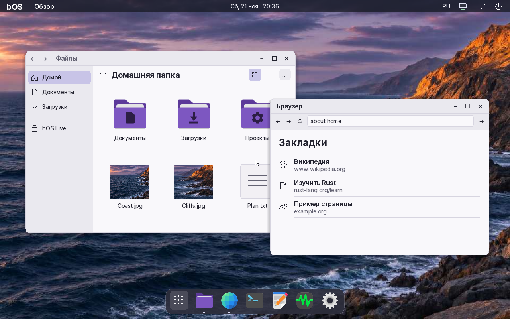
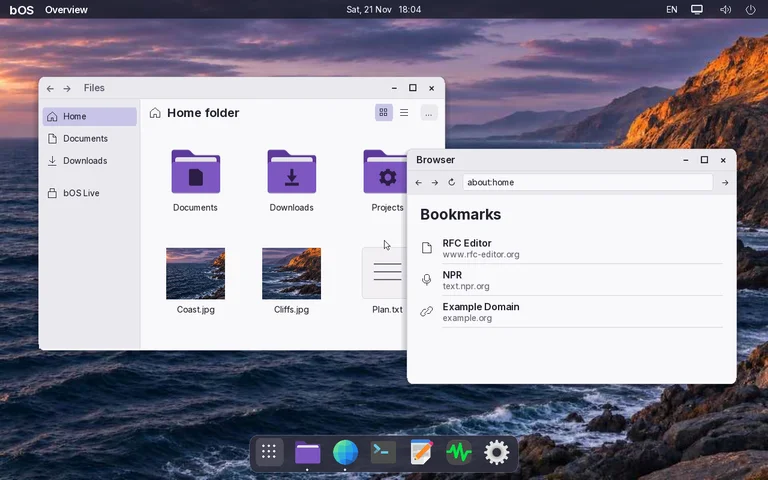
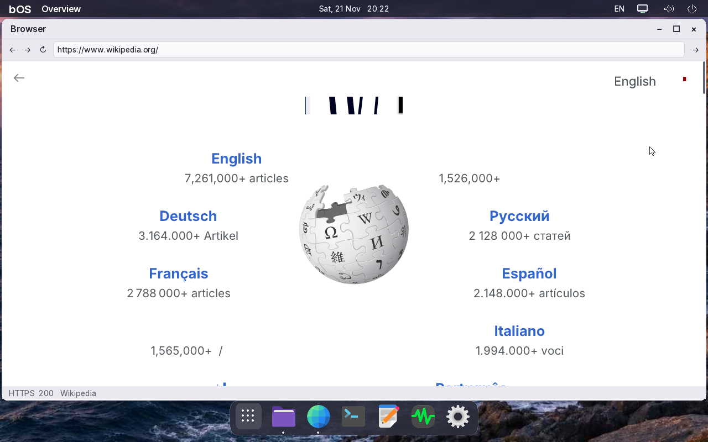

# bOS 1.0

[Скачать Live-образ](https://github.com/dr-lexus-dr/bOS/releases/download/v1.0.0/bOS-1.0.0-x86_64.img) · [Релиз и контрольная сумма](https://github.com/dr-lexus-dr/bOS/releases/tag/v1.0.0) · [English](README.md)

bOS — операционная система для x86-64 со своим ядром на Rust. Один образ загружается через BIOS и UEFI. При запуске открываются «Файлы» и браузер. Рабочий стол, терминал, сеть и движок браузера исполняются на компьютере, с которого загружена bOS.



## Запуск без установки

Скачайте образ и `SHA256SUMS` в одну папку и выполните `sha256sum -c SHA256SUMS`. Запишите образ на флешку в режиме записи образа диска и выберите её в меню загрузки компьютера. Запись заменит содержимое выбранной флешки. В дальнейшем загрузочный носитель может работать только для чтения.

В Linux с QEMU и KVM скачанный файл можно запустить напрямую.

```sh
qemu-system-x86_64 -machine pc -accel kvm -cpu host -smp 1 -m 1G \
  -device VGA,vgamem_mb=8 \
  -drive if=none,id=stick,format=raw,readonly=on,file=bOS-1.0.0-x86_64.img \
  -device qemu-xhci -device usb-storage,drive=stick,bootindex=1 \
  -netdev user,id=lan -device rtl8139,netdev=lan,romfile=
```

Для программной эмуляции замените `-accel kvm -cpu host` на `-accel tcg -cpu max,vendor=GenuineIntel`. Для работы с сайтами выделите виртуальной машине **1 ГиБ ОЗУ**. Размер образа около **17,5 МБ**. На физическом ПК нужны 32-битный видеорежим VBE или GOP, клавиатура и мышь PS/2. Проводная сеть работает через Realtek RTL8139, Intel 82540EM и Intel 82574L. Проверки выполнялись в QEMU с SeaBIOS и OVMF. [Измерения и оборудование](CONSTRAINTS.md)

## Рабочий стол

Тяните окно за заголовок, чтобы переместить его, и за нижний правый угол, чтобы изменить размер. Двойной щелчок по заголовку разворачивает окно. Щелчок по значку в доке возвращает свёрнутое окно. **Super** открывает обзор. Введите название приложения и нажмите **Enter**. Правая кнопка открывает контекстное меню, щелчок по часам — календарь, по индикатору сети — состояние соединения.



| Приложение | Возможности |
| --- | --- |
| Файлы | Каталоги в виде значков или списка, создание и переименование, копирование папок, просмотр JPEG и открытие текста в «Заметках». |
| Браузер | Адресная строка и поиск, ссылки, формы, история, прокрутка и обновление страницы. |
| Терминал | Команды bSH и пользовательские программы, цветной вывод, прокрутка. У каждого окна свой рабочий каталог и история. Tab дополняет команды и пути. |
| Заметки | Редактирование UTF-8, выделение мышью и клавиатурой, общий буфер обмена, сохранение под новым именем. |
| Калькулятор | Целочисленные выражения со скобками и четырьмя арифметическими действиями. |
| Системный монитор | График загрузки процессора, занятая память, время работы и количество окон. |
| Настройки | Язык, тема, акцент, обои, скорость анимации, тени, прозрачность, часы и скорость мыши. |
| Виджеты | Поле ввода, переключатель, ползунок, сегментированные кнопки, проверка динамика и сохранение текста. |
| Змейка | Стрелки или WASD управляют направлением. Пробел запускает и приостанавливает игру. |
| О системе | Версия, архитектура и ревизия исходников, из которых собрана система. |

При первом запуске интерфейс **английский**. Для перехода на русский нажмите **EN** в верхней панели или выберите **Settings → Language → Русский**. **Ctrl+Space** переключает раскладку клавиатуры отдельно от языка интерфейса. **Alt+Tab** переключает окна, **Alt+F4** закрывает активное окно, **F12** переключает рабочий стол и полноэкранную bSH. **Ctrl+L** открывает адресную строку, **Ctrl+B/F** перемещает по истории браузера, **Ctrl+S** сохраняет заметку.

## Браузер и интернет

В образ входит go-webengine с интерпретатором JavaScript Goja. Он собран в WebAssembly и выполняется в Wasmi внутри bOS. Система получает IPv4 по DHCP, разрешает имена через DNS и проверяет сертификаты HTTPS и время их действия. У каждого окна свой временный набор cookie. При загрузке с флешки движок, шрифты и корневые сертификаты уже на месте.



Браузер отображает HTML и CSS, включая flex и grid, загружает изображения и SVG, выполняет JavaScript и отправляет формы. Страница появляется после расчёта вёрстки, пока продолжают загружаться изображения и скрипты. Гостевые тесты проверяют размеры CSS-блока, изменение его цвета скриптом, переходы по ссылкам и настоящий POST-запрос. По публичному HTTPS проверены Википедия, Example Domain и сайт Learn Rust.

Совместимость с вебом частичная. Тяжёлые JavaScript-приложения могут открываться долго или работать не полностью. Потоковое видео, DRM, WebRTC и расширения браузера выходят за возможности этой версии. Размер одного загружаемого ресурса ограничен 8 МиБ. В терминале доступна отдельная текстовая команда `web https://example.com/` с пределом 64 КиБ. [Движок](https://github.com/go-webengine/engine/tree/v0.48.0) · [Архитектура](docs/ARCH.md)

## Хранение файлов и терминал

По умолчанию документы и настройки хранятся в ОЗУ до выключения. Чтобы сохранить их между загрузками, подключите отдельный том FAT12 или FAT16 с меткой **BOSDATA** либо существующий пользовательский том bFS. Он появится в `/users`. Домашний каталог — `/users/default`, настройки рабочего стола — `.config/desktop.cfg` внутри него. Для создания отдельного пустого тома из рабочей копии выполните команды ниже.

```sh
mkdir -p target
test ! -e target/users-fat.img && truncate -s 16M target/users-fat.img && \
  mkfs.fat -F 16 -n BOSDATA target/users-fat.img
BOS_DATA=target/users-fat.img bash scripts/run-qemu.sh --live
```

Live-образ включает семь программ ELF32. Совместимый с ClaudeOS интерфейс `int 0x80` поддерживает изоляцию адресных пространств, вытеснение, ожидание и фоновые задачи. В терминале или полноэкранной bSH доступны следующие команды.

```sh
hello one two
primes 30
counter 10 &
ps
ifconfig
mem
```

`joblog PID` показывает вывод фоновой задачи, `kill PID` её останавливает. Расширенная UEFI-сборка также предоставляет нативные приложения x86-64 и экспериментальный ABI статических Linux-программ с nash и uutils. [Примеры для i386](userspace/compat32) · [Системные вызовы](docs/abi.md) · [Расширенная сборка](docs/UPSTREAM-USERSPACE.md)

## Сборка и проверка

Для Linux x86-64 установите rustup, Go 1.27.4 или новее, Python 3, Clang, GNU binutils и patch. Репозиторий задаёт версию Rust nightly и цели сборки прошивки. Первая сборка загружает закреплённые зависимости Go и Cargo. Для Go вне PATH задайте абсолютный путь в `BOS_GO`. Для гостевых тестов понадобятся QEMU, OVMF, OpenSSL, dosfstools и Python Pillow.

```sh
bash scripts/build.sh --live
bash scripts/run-qemu.sh --live
bash scripts/test-host.sh
python3 scripts/test-live.py
python3 scripts/test-browser.py --uefi --public https://example.com/
python3 scripts/test-live-storage.py
```

Образ появится в `target/live/bos-live.img`. При доступном KVM скрипт запуска использует аппаратное ускорение. Команда `bash scripts/release.sh 1.0.0` создаёт версионированный образ и контрольную сумму. [Проверенные конфигурации](docs/STATUS.md) · [История изменений](CHANGELOG.md)

bOS распространяется под GPL-3.0. В образ включены значки Papirus, шрифты Inter и Terminus, Wasmi, go-webengine и декодер LZMA Игоря Павлова. Файл `NOTICES.TXT` находится в загрузочном разделе. Приложения и совместимость i386 реализованы по открытому интерфейсу ClaudeOS. [Лицензия](LICENSE) · [Сторонние компоненты](third_party) · [ClaudeOS](https://github.com/photonest444/claudeos)
